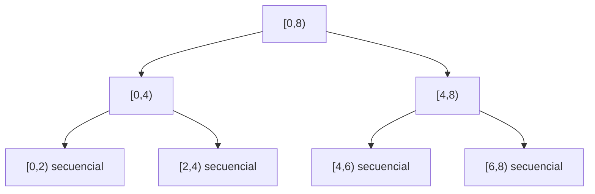

# Informe de paralelización

**Taller 4: Simulación de partículas en paralelo**

---

## 1. Estrategia de reparto

### Dónde se reparte

El reparto se hace en tres funciones de la clase `SimulacionParticulas`:

- `pasoParalelo`: avanza el sistema un paso de tiempo `dt`.
- `energiaParalela`: calcula la energía cinética total del sistema.
- `centroDeMasaParalelo`: calcula el centro de masa del sistema.

### Con qué abstracción

Se usa `parallel` del paquete `common`. En cada llamado el arreglo se parte en dos mitades (`mitad = s.length / 2`) y `parallel` ejecuta las dos mitades al mismo tiempo, devolviendo los dos resultados.

### Criterio para dejar de partir

Se deja de partir cuando el tramo tiene `umbral` elementos o menos, o cuando `umbral <= 0`. En ese caso se resuelve con la versión secuencial. Se hace así porque crear tareas tiene un costo: si el tramo es muy pequeño, repartirlo cuesta más de lo que ahorra.

### Operación que combina los resultados parciales

| Función | Resultado de cada mitad | Cómo se combinan |
|---|---|---|
| `pasoParalelo` | arreglo de partículas | concatenación `++` |
| `energiaParalela` | un `Double` | suma `+` |
| `centroDeMasaParalelo` | pareja (suma ponderada, masa) | suma componente a componente |

En el centro de masa se lleva la pareja (suma ponderada, masa) y se divide **una sola vez al final**. Promediar los promedios de cada mitad daría otro resultado cuando las mitades no pesan igual:

$$CM = \frac{\sum_i m_i \, \vec{r}_i}{\sum_i m_i}$$

### Diagrama del reparto

Ejemplo con un sistema de 8 partículas y umbral 2:

## 2. Tabla de tiempos

### 2.1 Condiciones de la medición

- **Máquina:** Intel Core i5-11400H, 16 GB de RAM (portátil).
- **Núcleos disponibles:** 12 (`Runtime.getRuntime.availableProcessors`). Son 6 núcleos físicos con 2 hilos cada uno (Hyper-Threading).
- **Herramienta:** ScalaMeter, con `withWarmer(new Warmer.Default)`.
- **Repeticiones:** 3 por medición; se reporta la **mediana**, en milisegundos.
- **Paso de tiempo:** $dt = 0{,}5$.
- **Sistema:** generado con `Array.tabulate`, con posición $(i,\ i \bmod 100)$, velocidad $(i \bmod 7,\ i \bmod 13)$ y masa $1 + (i \bmod 5)$.
- **Tamaños:** 1 000 000, 2 000 000 y 4 000 000 de partículas.
- **Umbrales:** 1 000, 10 000, 100 000, $n/2$ y $n$.
- **Calentamiento.** Cada medición usa `withWarmer(new Warmer.Default)` de ScalaMeter, que ejecuta el bloque repetidamente antes de medir para que la JVM se estabilice (compilación JIT, carga de clases). Aun así, el control ($u = n$) varió entre 0,34 y 2,36 entre corridas. Aunque el calentamiento reduce el efecto del arranque de la JVM, no elimina otras fuentes de variación: el recolector de basura, que se activa en momentos distintos porque cada paso crea arreglos de millones de objetos, la frecuencia variable de la CPU de un portátil y los procesos en segundo plano. Por eso los tiempos individuales varían entre corridas y las aceleraciones deben leerse con cautela.

La aceleración se calcula como:

$$S = \frac{T_{sec}}{T_{par}}$$

### 2.2 Resultados

Los datos son de una sola corrida completa de `App.scala`, sin mezclar filas de corridas distintas.

| Tamaño $n$ | Umbral $u$ | $T_{sec}$ (ms) | $T_{par}$ (ms) | Aceleración $S$ | Nota |
|---:|---:|---:|---:|---:|---|
| 1 000 000 | 1 000 | 38,21 | 26,12 | 1,46 | |
| 1 000 000 | 10 000 | 38,21 | 19,87 | 1,92 | |
| 1 000 000 | 100 000 | 38,21 | 20,84 | 1,83 | |
| 1 000 000 | 500 000 | 38,21 | 16,30 | 2,34 | |
| 1 000 000 | 1 000 000 | 38,21 | 25,93 | 1,47 | control |
| 2 000 000 | 1 000 | 65,39 | 178,26 | 0,37 | |
| 2 000 000 | 10 000 | 65,39 | 150,71 | 0,43 | |
| 2 000 000 | 100 000 | 65,39 | 139,29 | 0,47 | |
| 2 000 000 | 1 000 000 | 65,39 | 102,96 | 0,64 | |
| 2 000 000 | 2 000 000 | 65,39 | 63,94 | 1,02 | control |
| 4 000 000 | 1 000 | 292,88 | 346,53 | 0,85 | |
| 4 000 000 | 10 000 | 292,88 | 271,01 | 1,08 | |
| 4 000 000 | 100 000 | 292,88 | 293,32 | 1,00 | |
| 4 000 000 | 2 000 000 | 292,88 | 182,68 | 1,60 | |
| 4 000 000 | 4 000 000 | 292,88 | 285,68 | 1,03 | control |

### 2.3 Fila de control

Cuando $u = n$, `pasoParalelo` no reparte nada y llama directamente a `pasoSecuencial`, así que ambas versiones hacen el mismo trabajo y la aceleración debe ser cercana a 1.

- Con $n = 2\,000\,000$ y $n = 4\,000\,000$ el control dio $S = 1{,}02$ y $S = 1{,}03$, como se esperaba.
- Con $n = 1\,000\,000$ dio $S = 1{,}47$. El secuencial de esa corrida (38,21 ms) quedó más alto que en otras corridas del mismo tamaño (entre 18 y 30 ms), así que atribuimos la desviación al ruido de la medición y no al reparto.

Elegimos esta corrida como tabla principal porque dos de los tres controles quedaron cerca de 1. Las demás corridas se muestran en la siguiente sección.

### 2.4 Variabilidad del control

Se ejecutó `App.scala` cinco veces, sin cambiar el código. Estas son las aceleraciones del control ($u = n$) en cada corrida:

| $n$ | Corrida 1 | Corrida 2 | Corrida 3 | Corrida 4 | Corrida 5 (tabla 2.2) |
|---:|---:|---:|---:|---:|---:|
| 1 000 000 | 1,86 | 0,99 | 1,03 | 0,86 | 1,47 |
| 2 000 000 | 1,60 | 1,65 | 0,34 | 1,25 | 1,02 |
| 4 000 000 | 1,59 | 1,16 | 0,40 | 2,36 | 1,03 |

El control varió entre 0,34 y 2,36 aunque el código es idéntico al secuencial. Por eso las aceleraciones individuales de la tabla 2.2 deben leerse con cautela.

### 2.5 Observaciones

- **Umbrales pequeños** (1 000 y 10 000): en 2M quedaron muy por debajo de 1 (0,37 y 0,43), y en 4M dieron 0,85 y 1,08. En las cinco corridas casi nunca ganaron de forma estable.
- **Tamaños de 2M y 4M:** la aceleración con $u = n/2$ no fue estable (0,64 en 2M y 1,60 en 4M).
- **Tamaño de 1M:** todas las filas, incluido el control, dieron más de 1, lo que indica que el secuencial salió inflado en esa corrida.
- **Ninguna aceleración se acercó a 6** (núcleos físicos) **ni a 12** (hilos).

## 3. Comparación con la estimación del punto 4

El punto 4 del taller estima el costo de repartir el cálculo sin ejecutar nada. Aquí se contrasta esa estimación con lo que midió `App.scala`.

### 3.1 Qué estima el modelo

Para $n$ partículas, $p$ procesadores y un umbral $u$:

$$\text{trabajo}(n) = n$$

$$\text{profundidad}(n, u) = \begin{cases} n & \text{si } n \le u \\ 1 + \text{profundidad}\left(\left\lfloor \tfrac{n}{2} \right\rfloor, u\right) & \text{si } n > u \end{cases}$$

$$T_{est}(n, p, u) = \frac{n}{p} + \text{profundidad}(n, u)$$

- El **trabajo** es una operación por partícula y no baja por repartir.
- La **profundidad** cuenta las veces que se parte el sistema a la mitad, más el tramo que queda sin partir.
- El **tiempo estimado** es la profundidad más el trabajo repartido entre los $p$ procesadores.

Como la versión secuencial hace $n$ operaciones, la aceleración estimada es:

$$S_{est} = \frac{n}{T_{est}}$$

### 3.2 Números estimados

Sistema de $n = 1\,000\,000$ partículas y $p = ▢$ núcleos (los que imprime `App.scala`). Los valores de la tabla usan $p = 4$ como ejemplo.

| Umbral $u$ | Particiones | Tramo final | Profundidad | $T_{est}$ | $S_{est}$ | $S$ medida |
|---:|---:|---:|---:|---:|---:|---:|
| 1 000 | 10 | 976 | 986 | 250 986 | 3,98 | ▢ |
| 10 000 | 7 | 7 812 | 7 819 | 257 819 | 3,88 | ▢ |
| 100 000 | 4 | 62 500 | 62 504 | 312 504 | 3,20 | ▢ |
| 250 000 | 2 | 250 000 | 250 002 | 500 002 | 2,00 | ▢ |
| 1 000 000 (control) | 0 | 1 000 000 | 1 000 000 | 1 250 000 | 0,80 | ▢ (debe dar ≈ 1) |

> Si la máquina no tiene 4 núcleos, cambie $p$ y recalcule la columna $T_{est}$. La profundidad no cambia, solo $\frac{n}{p}$.

### 3.3 En qué se parecen

▢ Completar con los números medidos. Ideas para escribirlo en sus palabras:

- Tanto el modelo como la medición muestran que la aceleración **baja cuando el umbral crece**.
- Con el umbral igual al tamaño del sistema no se reparte nada y **no hay ganancia**.
- La aceleración, estimada o medida, **nunca supera el número de núcleos**.

### 3.4 En qué no se parecen

▢ Completar con los números medidos. Diferencias esperables:

| Aspecto | Lo que dice el modelo | Lo que se espera medir |
|---|---|---|
| Umbral pequeño | Mientras más pequeño, mejor ($S_{est}$ máxima con $u = 1\,000$) | Un umbral demasiado pequeño crea demasiadas tareas y el reparto cuesta más de lo que ahorra |
| Fila de control | $S_{est} = 0{,}8 < 1$, porque suma el tramo sin partir además de $\frac{n}{p}$ | $S \approx 1$, porque no se reparte nada y ambas versiones hacen lo mismo |
| Unidades | Números sin unidad, que cuentan operaciones | Milisegundos |
| Magnitud de la aceleración | Casi $p$ para umbrales pequeños | Menor que $p$ |

### 3.5 A qué lo atribuimos

El modelo solo cuenta operaciones por partícula. No incluye:

1. **El costo de crear y sincronizar tareas** con `parallel`.
2. **Las copias de arreglos** que hacen `slice` y `++` en `pasoParalelo`, que son trabajo que la versión secuencial no hace.
3. **El recolector de basura**, que trabaja más cuando se crean muchos arreglos intermedios.
4. **El ancho de banda de la memoria**, que comparten todos los núcleos.
5. **El calentamiento de la JVM**, que afecta las primeras ejecuciones.

Estos costos explican por qué la aceleración medida queda por debajo de la estimada y por qué el umbral más pequeño no resulta el mejor.

