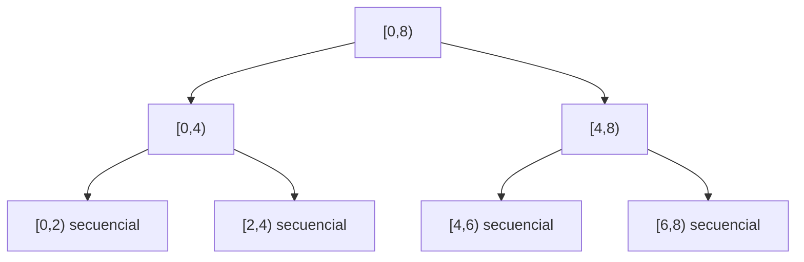

# Informe de paralelización

**Taller 4: Simulación de partículas en paralelo**

---

## 1. Estrategia de reparto

### Dónde se reparte

El reparto se hace en tres funciones de la clase `SimulacionParticulas`:

- `pasoParalelo`: avanza el sistema un paso de tiempo `dt`.
- `energiaParalela`: calcula la energía cinética total del sistema.
- `centroDeMasaParalelo`: calcula el centro de masa del sistema.

### Con qué abstracción

Se usa `parallel` del paquete `common`. En cada llamado el arreglo se parte en dos mitades (`mitad = s.length / 2`) y `parallel` ejecuta las dos mitades al mismo tiempo, devolviendo los dos resultados.

### Criterio para dejar de partir

Se deja de partir cuando el tramo tiene `umbral` elementos o menos, o cuando `umbral <= 0`. En ese caso se resuelve con la versión secuencial. Se hace así porque crear tareas tiene un costo: si el tramo es muy pequeño, repartirlo cuesta más de lo que ahorra.

### Operación que combina los resultados parciales

| Función | Resultado de cada mitad | Cómo se combinan |
|---|---|---|
| `pasoParalelo` | arreglo de partículas | concatenación `++` |
| `energiaParalela` | un `Double` | suma `+` |
| `centroDeMasaParalelo` | pareja (suma ponderada, masa) | suma componente a componente |

En el centro de masa se lleva la pareja (suma ponderada, masa) y se divide **una sola vez al final**. Promediar los promedios de cada mitad daría otro resultado cuando las mitades no pesan igual:

$$CM = \frac{\sum_i m_i \, \vec{r}_i}{\sum_i m_i}$$

### Diagrama del reparto

Ejemplo con un sistema de 8 partículas y umbral 2:

## 2. Tabla de tiempos

### 2.1 Condiciones de la medición

- **Máquina:** Intel Core i5-11400H, 16 GB de RAM (portátil).
- **Núcleos disponibles:** 12 (`Runtime.getRuntime.availableProcessors`). Son 6 núcleos físicos con 2 hilos cada uno (Hyper-Threading).
- **Herramienta:** ScalaMeter, con `withWarmer(new Warmer.Default)`.
- **Repeticiones:** 3 por medición; se reporta la **mediana**, en milisegundos.
- **Paso de tiempo:** $dt = 0{,}5$.
- **Sistema:** generado con `Array.tabulate`, con posición $(i,\ i \bmod 100)$, velocidad $(i \bmod 7,\ i \bmod 13)$ y masa $1 + (i \bmod 5)$.
- **Tamaños:** 1 000 000, 2 000 000 y 4 000 000 de partículas.
- **Umbrales:** 1 000, 10 000, 100 000, $n/2$ y $n$.
- **Calentamiento.** Cada medición usa `withWarmer(new Warmer.Default)` de ScalaMeter, que ejecuta el bloque repetidamente antes de medir para que la JVM se estabilice (compilación JIT, carga de clases). Aun así, el control ($u = n$) varió entre 0,34 y 2,36 entre corridas. Aunque el calentamiento reduce el efecto del arranque de la JVM, no elimina otras fuentes de variación: el recolector de basura, que se activa en momentos distintos porque cada paso crea arreglos de millones de objetos, la frecuencia variable de la CPU de un portátil y los procesos en segundo plano. Por eso los tiempos individuales varían entre corridas y las aceleraciones deben leerse con cautela.

La aceleración se calcula como:

$$S = \frac{T_{sec}}{T_{par}}$$

### 2.2 Resultados

Los datos son de una sola corrida completa de `App.scala`, sin mezclar filas de corridas distintas.

| Tamaño $n$ | Umbral $u$ | $T_{sec}$ (ms) | $T_{par}$ (ms) | Aceleración $S$ | Nota |
|---:|---:|---:|---:|---:|---|
| 1 000 000 | 1 000 | 38,21 | 26,12 | 1,46 | |
| 1 000 000 | 10 000 | 38,21 | 19,87 | 1,92 | |
| 1 000 000 | 100 000 | 38,21 | 20,84 | 1,83 | |
| 1 000 000 | 500 000 | 38,21 | 16,30 | 2,34 | |
| 1 000 000 | 1 000 000 | 38,21 | 25,93 | 1,47 | control |
| 2 000 000 | 1 000 | 65,39 | 178,26 | 0,37 | |
| 2 000 000 | 10 000 | 65,39 | 150,71 | 0,43 | |
| 2 000 000 | 100 000 | 65,39 | 139,29 | 0,47 | |
| 2 000 000 | 1 000 000 | 65,39 | 102,96 | 0,64 | |
| 2 000 000 | 2 000 000 | 65,39 | 63,94 | 1,02 | control |
| 4 000 000 | 1 000 | 292,88 | 346,53 | 0,85 | |
| 4 000 000 | 10 000 | 292,88 | 271,01 | 1,08 | |
| 4 000 000 | 100 000 | 292,88 | 293,32 | 1,00 | |
| 4 000 000 | 2 000 000 | 292,88 | 182,68 | 1,60 | |
| 4 000 000 | 4 000 000 | 292,88 | 285,68 | 1,03 | control |

### 2.3 Fila de control

Cuando $u = n$, `pasoParalelo` no reparte nada y llama directamente a `pasoSecuencial`, así que ambas versiones hacen el mismo trabajo y la aceleración debe ser cercana a 1.

- Con $n = 2\,000\,000$ y $n = 4\,000\,000$ el control dio $S = 1{,}02$ y $S = 1{,}03$, como se esperaba.
- Con $n = 1\,000\,000$ dio $S = 1{,}47$. El secuencial de esa corrida (38,21 ms) quedó más alto que en otras corridas del mismo tamaño (entre 18 y 30 ms), así que atribuimos la desviación al ruido de la medición y no al reparto.

Elegimos esta corrida como tabla principal porque dos de los tres controles quedaron cerca de 1. Las demás corridas se muestran en la siguiente sección.

### 2.4 Variabilidad del control

Se ejecutó `App.scala` cinco veces, sin cambiar el código. Estas son las aceleraciones del control ($u = n$) en cada corrida:

| $n$ | Corrida 1 | Corrida 2 | Corrida 3 | Corrida 4 | Corrida 5 (tabla 2.2) |
|---:|---:|---:|---:|---:|---:|
| 1 000 000 | 1,86 | 0,99 | 1,03 | 0,86 | 1,47 |
| 2 000 000 | 1,60 | 1,65 | 0,34 | 1,25 | 1,02 |
| 4 000 000 | 1,59 | 1,16 | 0,40 | 2,36 | 1,03 |

El control varió entre 0,34 y 2,36 aunque el código es idéntico al secuencial. Por eso las aceleraciones individuales de la tabla 2.2 deben leerse con cautela.

### 2.5 Observaciones

- **Umbrales pequeños** (1 000 y 10 000): en 2M quedaron muy por debajo de 1 (0,37 y 0,43), y en 4M dieron 0,85 y 1,08. En las cinco corridas casi nunca ganaron de forma estable.
- **Tamaños de 2M y 4M:** la aceleración con $u = n/2$ no fue estable (0,64 en 2M y 1,60 en 4M).
- **Tamaño de 1M:** todas las filas, incluido el control, dieron más de 1, lo que indica que el secuencial salió inflado en esa corrida.
- **Ninguna aceleración se acercó a 6** (núcleos físicos) **ni a 12** (hilos).

## 3. Comparación con la estimación del punto 4

El punto 4 del taller estima el costo del reparto sin ejecutar nada. Aquí se contrasta esa estimación con lo medido en la tabla 2.2.

### 3.1 Qué estima el modelo

Para $n$ partículas, $p$ procesadores y un umbral $u$:

$$\text{trabajo}(n) = n$$

$$\text{profundidad}(n, u) = \begin{cases} n & \text{si } n \le u \\ 1 + \text{profundidad}\left(\left\lfloor \tfrac{n}{2} \right\rfloor, u\right) & \text{si } n > u \end{cases}$$

$$T_{est}(n, p, u) = \frac{n}{p} + \text{profundidad}(n, u)$$

Como la versión secuencial hace $n$ operaciones, la aceleración estimada es:

$$S_{est} = \frac{n}{T_{est}}$$

Se usa $p = 12$, que es lo que reporta `availableProcessors`. Son 12 hilos sobre 6 núcleos físicos, así que el modelo es optimista.

### 3.2 Estimado frente a medido

La aceleración medida sale de la tabla 2.2. Las filas de control son $u = n$.

**$n = 1\,000\,000$**

| Umbral $u$ | Profundidad | $T_{est}$ | $S_{est}$ | $S$ medida |
|---:|---:|---:|---:|---:|
| 1 000 | 986 | 84 319 | 11,86 | 1,46 |
| 10 000 | 7 819 | 91 152 | 10,97 | 1,92 |
| 100 000 | 62 504 | 145 837 | 6,86 | 1,83 |
| 500 000 | 500 001 | 583 334 | 1,71 | 2,34 |
| 1 000 000 (control) | 1 000 000 | 1 083 333 | 0,92 | 1,47 |

**$n = 2\,000\,000$**

| Umbral $u$ | Profundidad | $T_{est}$ | $S_{est}$ | $S$ medida |
|---:|---:|---:|---:|---:|
| 1 000 | 987 | 167 654 | 11,93 | 0,37 |
| 10 000 | 7 820 | 174 487 | 11,46 | 0,43 |
| 100 000 | 62 505 | 229 172 | 8,73 | 0,47 |
| 1 000 000 | 1 000 001 | 1 166 668 | 1,71 | 0,64 |
| 2 000 000 (control) | 2 000 000 | 2 166 667 | 0,92 | 1,02 |

**$n = 4\,000\,000$**

| Umbral $u$ | Profundidad | $T_{est}$ | $S_{est}$ | $S$ medida |
|---:|---:|---:|---:|---:|
| 1 000 | 988 | 334 321 | 11,96 | 0,85 |
| 10 000 | 7 821 | 341 154 | 11,72 | 1,08 |
| 100 000 | 62 506 | 395 839 | 10,11 | 1,00 |
| 2 000 000 | 2 000 001 | 2 333 334 | 1,71 | 1,60 |
| 4 000 000 (control) | 4 000 000 | 4 333 333 | 0,92 | 1,03 |

### 3.3 En qué se parecen

- **Sin reparto no hay ganancia.** Con $u = n$ el modelo da $S_{est} = 0{,}92$ y lo medido quedó entre 1,02 y 1,47. En ambos casos no hay una mejora real.
- **Ninguna aceleración supera el número de procesadores.** La estimada llega a 11,96 y la medida a 2,34, ambas por debajo de 12.
- **Partir una sola vez ($u = n/2$) da poca ganancia.** El modelo estima 1,71. Lo medido en 4M fue 1,60, bastante cercano, aunque en 2M fue 0,64, así que no se mantiene.

### 3.4 En qué no se parecen

| Aspecto | Lo que dice el modelo | Lo que se midió |
|---|---|---|
| Umbral pequeño | Es el mejor: $S_{est}$ entre 11,86 y 11,96 con $u = 1\,000$ | Es de los peores: 0,37 en 2M y 0,85 en 4M |
| Magnitud | Cercana a $p$ para umbrales pequeños | Máxima de 2,34, lejos de 6 y de 12 |
| Tendencia con $u$ | $S_{est}$ baja siempre al crecer $u$ | Sin tendencia clara: sube y baja entre filas |
| Control | $S_{est} = 0{,}92$ | Cerca de 1 en 2M y 4M, y 1,47 en 1M |
| Unidades | Operaciones, sin unidad de tiempo | Milisegundos |

El control del modelo da 0,92 y no 1 porque la profundidad suma el tramo sin partir ($n$) a $\frac{n}{p}$, mientras que en la ejecución real ambas versiones son el mismo código.

### 3.5 A qué lo atribuimos

El modelo solo cuenta una operación por partícula. No incluye:

1. **La creación de objetos.** Cada paso construye un arreglo nuevo de millones de `Particula`, y ese costo domina sobre el cálculo, que es una suma y un producto por partícula.
2. **Las copias de `slice` y `++`** en `pasoParalelo`, que la versión secuencial no hace. Con umbrales pequeños se hacen muchas más copias.
3. **El costo de crear y sincronizar tareas** con `parallel`, que crece con el número de tramos.
4. **El recolector de basura**, que probablemente trabaja más con tantos arreglos intermedios. Es la causa más probable de la variabilidad del control (tabla 2.4), aunque no la medimos directamente.
5. **El ancho de banda de la memoria**, que comparten todos los núcleos.
6. **Los hilos lógicos.** Los 12 procesadores del modelo son 6 núcleos físicos con Hyper-Threading, que no rinden como 12 núcleos independientes.
7. **El entorno.** Un portátil puede bajar la frecuencia por temperatura, lo que explica parte de la variación entre corridas.

Aunque cada medición usa `withWarmer(new Warmer.Default)`, el calentamiento solo cubre el arranque de la JVM y no elimina estas fuentes de variación. Por eso la aceleración medida queda muy por debajo de la estimada y el umbral más pequeño, que el modelo prefiere, resultó de los peores. Como el control varió entre 0,34 y 2,36, las diferencias pequeñas entre filas pueden ser ruido.
