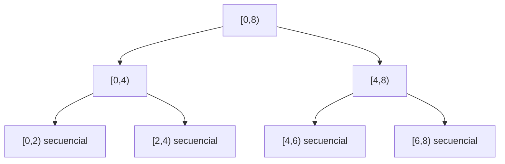

# Informe de paralelización

**Taller 4: Simulación de partículas en paralelo**

---

## 1. Estrategia de reparto

### Dónde se reparte

El reparto se hace en tres funciones de la clase `SimulacionParticulas`:

- `pasoParalelo`: avanza el sistema un paso de tiempo `dt`.
- `energiaParalela`: calcula la energía cinética total del sistema.
- `centroDeMasaParalelo`: calcula el centro de masa del sistema.

### Con qué abstracción

Se usa `parallel` del paquete `common`. En cada llamado el arreglo se parte en dos mitades (`mitad = s.length / 2`) y `parallel` ejecuta las dos mitades al mismo tiempo, devolviendo los dos resultados.

### Criterio para dejar de partir

Se deja de partir cuando el tramo tiene `umbral` elementos o menos, o cuando `umbral <= 0`. En ese caso se resuelve con la versión secuencial. Se hace así porque crear tareas tiene un costo: si el tramo es muy pequeño, repartirlo cuesta más de lo que ahorra.

### Operación que combina los resultados parciales

| Función | Resultado de cada mitad | Cómo se combinan |
|---|---|---|
| `pasoParalelo` | arreglo de partículas | concatenación `++` |
| `energiaParalela` | un `Double` | suma `+` |
| `centroDeMasaParalelo` | pareja (suma ponderada, masa) | suma componente a componente |

En el centro de masa se lleva la pareja (suma ponderada, masa) y se divide **una sola vez al final**. Promediar los promedios de cada mitad daría otro resultado cuando las mitades no pesan igual:

$$CM = \frac{\sum_i m_i \, \vec{r}_i}{\sum_i m_i}$$

### Diagrama del reparto

Ejemplo con un sistema de 8 partículas y umbral 2:

## 3. Comparación con la estimación del punto 4

El punto 4 del taller estima el costo de repartir el cálculo sin ejecutar nada. Aquí se contrasta esa estimación con lo que midió `App.scala`.

### 3.1 Qué estima el modelo

Para $n$ partículas, $p$ procesadores y un umbral $u$:

$$\text{trabajo}(n) = n$$

$$\text{profundidad}(n, u) = \begin{cases} n & \text{si } n \le u \\ 1 + \text{profundidad}\left(\left\lfloor \tfrac{n}{2} \right\rfloor, u\right) & \text{si } n > u \end{cases}$$

$$T_{est}(n, p, u) = \frac{n}{p} + \text{profundidad}(n, u)$$

- El **trabajo** es una operación por partícula y no baja por repartir.
- La **profundidad** cuenta las veces que se parte el sistema a la mitad, más el tramo que queda sin partir.
- El **tiempo estimado** es la profundidad más el trabajo repartido entre los $p$ procesadores.

Como la versión secuencial hace $n$ operaciones, la aceleración estimada es:

$$S_{est} = \frac{n}{T_{est}}$$

### 3.2 Números estimados

Sistema de $n = 1\,000\,000$ partículas y $p = ▢$ núcleos (los que imprime `App.scala`). Los valores de la tabla usan $p = 4$ como ejemplo.

| Umbral $u$ | Particiones | Tramo final | Profundidad | $T_{est}$ | $S_{est}$ | $S$ medida |
|---:|---:|---:|---:|---:|---:|---:|
| 1 000 | 10 | 976 | 986 | 250 986 | 3,98 | ▢ |
| 10 000 | 7 | 7 812 | 7 819 | 257 819 | 3,88 | ▢ |
| 100 000 | 4 | 62 500 | 62 504 | 312 504 | 3,20 | ▢ |
| 250 000 | 2 | 250 000 | 250 002 | 500 002 | 2,00 | ▢ |
| 1 000 000 (control) | 0 | 1 000 000 | 1 000 000 | 1 250 000 | 0,80 | ▢ (debe dar ≈ 1) |

> Si la máquina no tiene 4 núcleos, cambie $p$ y recalcule la columna $T_{est}$. La profundidad no cambia, solo $\frac{n}{p}$.

### 3.3 En qué se parecen

▢ Completar con los números medidos. Ideas para escribirlo en sus palabras:

- Tanto el modelo como la medición muestran que la aceleración **baja cuando el umbral crece**.
- Con el umbral igual al tamaño del sistema no se reparte nada y **no hay ganancia**.
- La aceleración, estimada o medida, **nunca supera el número de núcleos**.

### 3.4 En qué no se parecen

▢ Completar con los números medidos. Diferencias esperables:

| Aspecto | Lo que dice el modelo | Lo que se espera medir |
|---|---|---|
| Umbral pequeño | Mientras más pequeño, mejor ($S_{est}$ máxima con $u = 1\,000$) | Un umbral demasiado pequeño crea demasiadas tareas y el reparto cuesta más de lo que ahorra |
| Fila de control | $S_{est} = 0{,}8 < 1$, porque suma el tramo sin partir además de $\frac{n}{p}$ | $S \approx 1$, porque no se reparte nada y ambas versiones hacen lo mismo |
| Unidades | Números sin unidad, que cuentan operaciones | Milisegundos |
| Magnitud de la aceleración | Casi $p$ para umbrales pequeños | Menor que $p$ |

### 3.5 A qué lo atribuimos

El modelo solo cuenta operaciones por partícula. No incluye:

1. **El costo de crear y sincronizar tareas** con `parallel`.
2. **Las copias de arreglos** que hacen `slice` y `++` en `pasoParalelo`, que son trabajo que la versión secuencial no hace.
3. **El recolector de basura**, que trabaja más cuando se crean muchos arreglos intermedios.
4. **El ancho de banda de la memoria**, que comparten todos los núcleos.
5. **El calentamiento de la JVM**, que afecta las primeras ejecuciones.

Estos costos explican por qué la aceleración medida queda por debajo de la estimada y por qué el umbral más pequeño no resulta el mejor.

