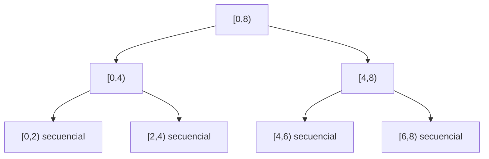

# Informe de paralelización

**Taller 4: Simulación de partículas en paralelo**

---

## 1. Estrategia de reparto

### Dónde se reparte

El reparto se hace en tres funciones de la clase `SimulacionParticulas`:

- `pasoParalelo`: avanza el sistema un paso de tiempo `dt`.
- `energiaParalela`: calcula la energía cinética total del sistema.
- `centroDeMasaParalelo`: calcula el centro de masa del sistema.

### Con qué abstracción

Se usa `parallel` del paquete `common`. En cada llamado el arreglo se parte en dos mitades (`mitad = s.length / 2`) y `parallel` ejecuta las dos mitades al mismo tiempo, devolviendo los dos resultados.

### Criterio para dejar de partir

Se deja de partir cuando el tramo tiene `umbral` elementos o menos, o cuando `umbral <= 0`. En ese caso se resuelve con la versión secuencial. Se hace así porque crear tareas tiene un costo: si el tramo es muy pequeño, repartirlo cuesta más de lo que ahorra.

### Operación que combina los resultados parciales

| Función | Resultado de cada mitad | Cómo se combinan |
|---|---|---|
| `pasoParalelo` | arreglo de partículas | concatenación `++` |
| `energiaParalela` | un `Double` | suma `+` |
| `centroDeMasaParalelo` | pareja (suma ponderada, masa) | suma componente a componente |

En el centro de masa se lleva la pareja (suma ponderada, masa) y se divide **una sola vez al final**. Promediar los promedios de cada mitad daría otro resultado cuando las mitades no pesan igual:

$$CM = \frac{\sum_i m_i \, \vec{r}_i}{\sum_i m_i}$$

### Diagrama del reparto

Ejemplo con un sistema de 8 partículas y umbral 2:

