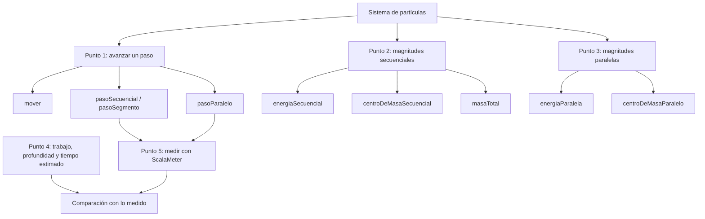
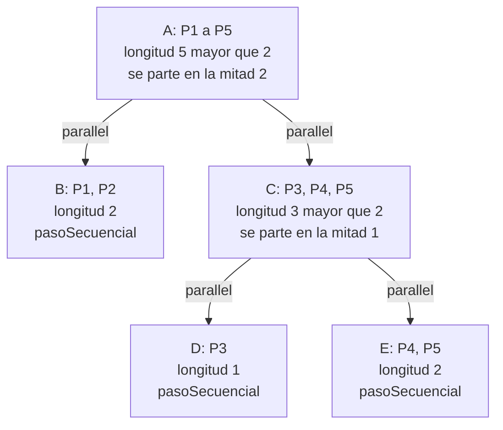
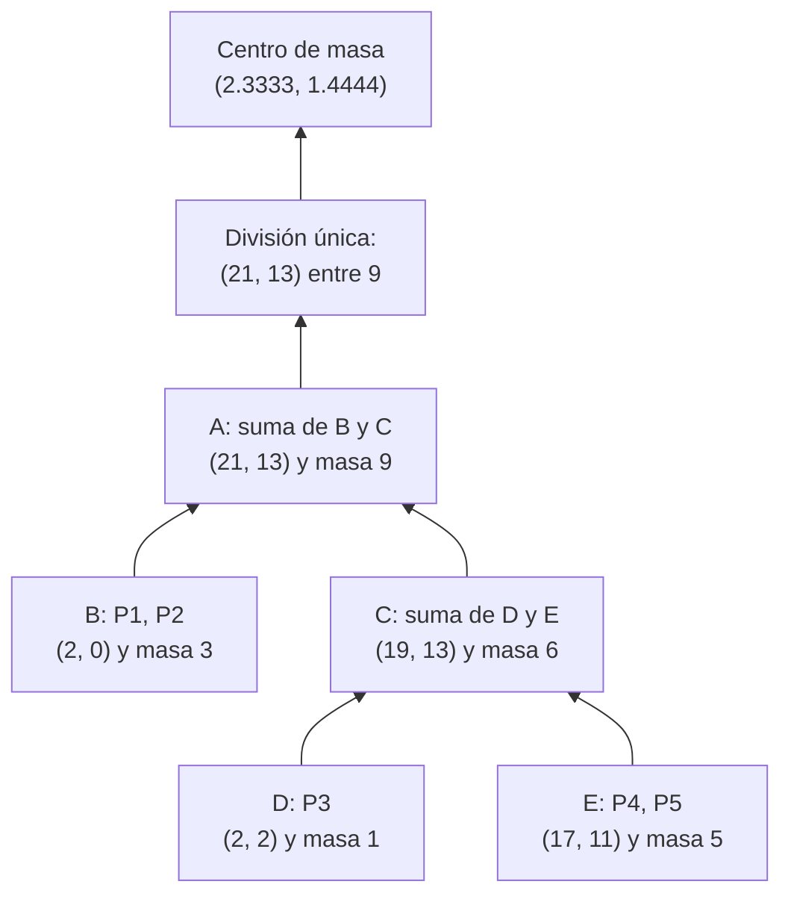
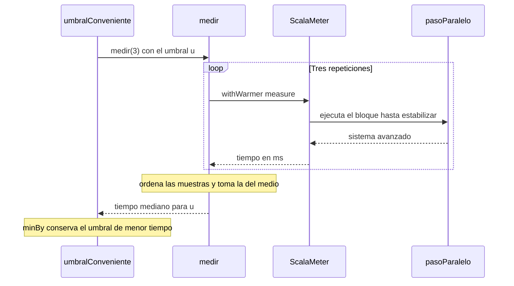

# Informe de proceso — Simulación de partículas en paralelo

## Contenido

1.  Introducción
2.  Contexto y modelo de datos
3.  Punto 1: un paso de la simulación
4.  Punto 2: magnitudes globales en secuencial
5.  Punto 3: las mismas magnitudes en paralelo
6.  Punto 4: trabajo y profundidad
7.  Punto 5: medir la aceleración
8.  Diagramas del proceso
9.  El resultado no depende del umbral
10. Uso de programación funcional
11. Conclusiones

----------

## 1. Introducción

El objetivo de este taller es implementar una simulación de partículas y calcular magnitudes globales del sistema (energía y centro de masa), repartiendo el trabajo entre varios núcleos con las abstracciones `parallel` y `task` del paquete `common`.

El desarrollo se realizó sin variables mutables, sin ciclos iterativos y sin `return`. Todas las operaciones se expresan como transformaciones de colecciones y recursión.

El informe explica, para cada función, cómo se ejecuta paso a paso, qué tramo del sistema resuelve cada llamado en las versiones repartidas y cómo se combinan los resultados parciales. Cada función se acompaña de una traza con un ejemplo pequeño.

----------

## 2. Contexto y modelo de datos

El taller proporciona los siguientes tipos, que se conservan sin modificaciones:

```scala
case class Vector2(x: Double, y: Double) {
  def +(o: Vector2): Vector2 = Vector2(x + o.x, y + o.y)
  def *(k: Double): Vector2  = Vector2(x * k, y * k)
  def norma: Double          = Math.sqrt(x * x + y * y)
}

case class Particula(pos: Vector2, vel: Vector2, masa: Double)

type Sistema = Array[Particula]

```

Un sistema es un arreglo de partículas. Cada partícula tiene una posición, una velocidad y una masa.

Para realizar las trazas se utiliza el siguiente sistema de cinco partículas, con un paso de tiempo `dt = 2.0`:

```scala
val s = Array(
  Particula(Vector2(0, 0), Vector2( 1, 2), 1.0),  // P1
  Particula(Vector2(1, 0), Vector2( 0, 1), 2.0),  // P2
  Particula(Vector2(2, 2), Vector2( 1, 0), 1.0),  // P3
  Particula(Vector2(3, 1), Vector2(-1, 1), 3.0),  // P4
  Particula(Vector2(4, 4), Vector2( 0, 0), 2.0)   // P5
)

```

```
| Elemento | Posición | Velocidad | Masa |
|----------|----------|-----------|------|
| P1 | (0, 0) | (1, 2) | 1.0 |
| P2 | (1, 0) | (0, 1) | 2.0 |
| P3 | (2, 2) | (1, 0) | 1.0 |
| P4 | (3, 1) | (-1, 1) | 3.0 |
| P5 | (4, 4) | (0, 0) | 2.0 |
```

El orden de estos elementos corresponde al orden original del arreglo. Con `dt = 2.0`, la partícula nueva de `Pk` se escribe `Pk'`.

Las funciones están definidas dentro de la clase `SimulacionParticulas`. Además de las funciones pedidas, se usa la función `medir`, que viene en el repositorio y se describe en la sección 7.


## 3. Punto 1: un paso de la simulación

### 3.1. Función auxiliar `mover`

La función `mover` calcula cómo queda una sola partícula después de un paso de tiempo. Las demás funciones de este punto se apoyan en ella.

Código completo:

```scala
def mover(p: Particula, dt: Double): Particula = {
  new Particula(p.pos + (p.vel * dt), p.vel, p.masa)
}

```

En notación matemática, si la partícula $p$ tiene posición $r$ y velocidad $v$:

$$ r' = r + v \cdot dt $$

**Proceso:**

1.  Se multiplica la velocidad por `dt` con el operador `*` de `Vector2`.
2.  Se suma ese desplazamiento a la posición con el operador `+` de `Vector2`.
3.  Se construye una partícula nueva con la posición calculada y la misma velocidad y masa.

La partícula original no se modifica: se devuelve una partícula nueva.

**Traza con `mover(P1, 2.0)`:**

text

```text
+------+--------------------------------------------+------------------------------------+
| Paso | Operación                                  | Resultado                          |
+------+--------------------------------------------+------------------------------------+
| 1    | vel * dt = (1, 2) * 2.0                    | (2.0, 4.0)                         |
| 2    | pos + desplazamiento = (0, 0) + (2.0, 4.0) | (2.0, 4.0)                         |
| 3    | Partícula nueva                            | Particula((2.0, 4.0), (1, 2), 1.0) |
+------+--------------------------------------------+------------------------------------+
```
### 3.2. Función `pasoSecuencial`

La función `pasoSecuencial` avanza todo el sistema un paso de tiempo `dt`.

Código completo:

scala

```scala
def pasoSecuencial(s: Sistema, dt: Double): Sistema = {
  s.map(mover(_, dt))
}
```

La expresión `mover(_, dt)` equivale a `p => mover(p, dt)`.

**Proceso:**

1.  Se recorre el arreglo de izquierda a derecha.
2.  A cada partícula se le aplica `mover` con el mismo `dt`.
3.  Se construye un arreglo nuevo con los resultados, en el mismo orden y con la misma longitud.

**Traza con `pasoSecuencial(s, 2.0)`:**

text

```text
+-----------+-------------------+----------+----------------+
| Partícula | Posición anterior | vel * dt | Posición nueva |
+-----------+-------------------+----------+----------------+
| P1        | (0, 0)            | (2, 4)   | (2, 4)         |
| P2        | (1, 0)            | (0, 2)   | (1, 2)         |
| P3        | (2, 2)            | (2, 0)   | (4, 2)         |
| P4        | (3, 1)            | (-2, 2)  | (1, 3)         |
| P5        | (4, 4)            | (0, 0)   | (4, 4)         |
+-----------+-------------------+----------+----------------+
```

Resultado: un arreglo con `P1'`, `P2'`, `P3'`, `P4'`, `P5'` en ese orden.

**Casos particulares:**

-   Con `dt = 0.0` todas las posiciones quedan igual.
-   Con un sistema vacío el resultado es un arreglo vacío.
-   El arreglo original no cambia.

### 3.3. Función `pasoSegmento`

La función `pasoSegmento` avanza solo el tramo entre `desde` (incluido) y `hasta` (excluido).

Código completo:

scala

```scala
def pasoSegmento(s: Sistema, dt: Double, desde: Int, hasta: Int): Sistema = {
  s.slice(desde, hasta).map(mover(_, dt))
}
```

**Proceso:**

1.  `slice(desde, hasta)` copia las partículas de las posiciones $desde, desde+1, \dots, hasta-1$.
2.  A cada partícula del tramo se le aplica `mover`.
3.  Se devuelve un arreglo con solo el tramo, de longitud $hasta - desde$. No se devuelve el sistema completo.

**Traza con `pasoSegmento(s, 2.0, 1, 4)`:**

text

```text
+------+------------------+---------------+
| Paso | Operación        | Resultado     |
+------+------------------+---------------+
| 1    | slice(1, 4)      | P2, P3, P4    |
| 2    | mover a cada una | P2', P3', P4' |
+------+------------------+---------------+
```

Resultado: posiciones `(1, 2)`, `(4, 2)`, `(1, 3)`.

Si el tramo es vacío (por ejemplo `desde = hasta`), `slice` devuelve un arreglo vacío y el resultado también lo es.

### 3.4. Función `pasoParalelo`

La función `pasoParalelo` avanza el sistema repartiendo el trabajo. Parte el arreglo por la mitad con `parallel` mientras el tramo tenga más elementos que el umbral. Por debajo de esa cifra resuelve en secuencial.

Código completo:

scala

```scala
def pasoParalelo(s: Sistema, dt: Double, umbral: Int): Sistema = {
  if (umbral <= 0 || s.length <= umbral)
    pasoSecuencial(s, dt)
  else {
    val mitad = s.length / 2
    val (izquierda, derecha) = parallel(
      pasoParalelo(s.slice(0, mitad), dt, umbral),
      pasoParalelo(s.slice(mitad, s.length), dt, umbral))
    izquierda ++ derecha
  }
}
```

**Proceso:**

1.  Se evalúa el criterio de parada: si `umbral <= 0` o el tramo tiene como máximo `umbral` elementos, se resuelve con `pasoSecuencial`.
2.  En caso contrario se calcula `mitad = s.length / 2`.
3.  Se crean los dos tramos: `[0, mitad)` y `[mitad, s.length)`.
4.  `parallel` ejecuta a la vez el llamado recursivo sobre cada tramo.
5.  Cuando los dos terminan, se concatenan con `++`: primero la mitad izquierda y luego la derecha, de modo que el orden original se conserva.

Cuando $umbral \ge 1$ y el tramo tiene más de `umbral` elementos, tiene al menos dos. Por eso `mitad` es al menos 1 y las dos mitades son no vacías y más cortas que el tramo original. Cada llamado trabaja sobre un arreglo estrictamente más corto, así que la recursión termina.

**Traza con `pasoParalelo(s, 2.0, 2)`:**

text

```text
+---------+--------------------+----------+----------------+----------------------------------------------------+
| Llamado | Tramo              | Longitud | ¿Longitud > 2? | Acción                                             |
+---------+--------------------+----------+----------------+----------------------------------------------------+
| A       | P1, P2, P3, P4, P5 | 5        | Sí             | mitad = 2: se parte en B (P1, P2) y C (P3, P4, P5) |
| B       | P1, P2             | 2        | No             | pasoSecuencial -> P1', P2'                         |
| C       | P3, P4, P5         | 3        | Sí             | mitad = 1: se parte en D (P3) y E (P4, P5)         |
| D       | P3                 | 1        | No             | pasoSecuencial -> P3'                              |
| E       | P4, P5             | 2        | No             | pasoSecuencial -> P4', P5'                         |
+---------+--------------------+----------+----------------+----------------------------------------------------+
```

B y C se ejecutan en paralelo entre sí. Dentro de C, D y E también se ejecutan en paralelo.

**Combinación de los resultados:**

1.  C combina sus dos resultados: `D ++ E` = P3', P4', P5'.
2.  A combina los suyos: `B ++ C` = P1', P2', P3', P4', P5'.

El resultado coincide con el de `pasoSecuencial(s, 2.0)`: mismas partículas, en el mismo orden.

**Casos particulares:**

-   `umbral <= 0`: se resuelve todo en secuencial, sin partir.
-   `umbral >= s.length`: no se reparte nada. Es el caso de control del punto 5, porque se llama a `pasoSecuencial(s, dt)` sin copiar el arreglo.
-   `umbral = 1`: se parte hasta llegar a tramos de una sola partícula.
-   `pasoParalelo(Array(p), 2.0, 1)` con una sola partícula no parte, porque $1 \le 1$.

Cada llamado que parte el tramo crea copias con `slice` y un arreglo nuevo con `++`. Ese costo extra explica por qué un umbral demasiado pequeño no conviene (se retoma en el informe de paralelización).

----------

## 4. Punto 2: magnitudes globales en secuencial

### 4.1. Función `energiaSecuencial`

La energía cinética del sistema es la suma de $\tfrac{1}{2} m v^2$ de cada partícula, donde $v$ es la norma de su velocidad.

$$E = \sum_{i} \frac{1}{2}\, m_i \,\lVert v_i \rVert^2$$

Código completo:

scala

```scala
def energiaSecuencial(s: Sistema): Double = {
  s.map(p => 0.5 * p.masa * math.pow(p.vel.norma, 2)).sum
}
```

**Proceso:**

1.  Para cada partícula se calcula la norma de su velocidad.
2.  Se eleva la norma al cuadrado y se multiplica por la masa y por 0.5.
3.  Se suman todas las energías individuales.

**Traza con `energiaSecuencial(s)`:**

text

```text
+-----------+-----------+---------+---------+---------------------+
| Partícula | Velocidad | Norma   | Norma^2 | Energía (1/2)*m*v^2 |
+-----------+-----------+---------+---------+---------------------+
| P1        | (1, 2)    | raiz(5) | 5       | 0.5 * 1 * 5 = 2.5   |
| P2        | (0, 1)    | 1       | 1       | 0.5 * 2 * 1 = 1.0   |
| P3        | (1, 0)    | 1       | 1       | 0.5 * 1 * 1 = 0.5   |
| P4        | (-1, 1)   | raiz(2) | 2       | 0.5 * 3 * 2 = 3.0   |
| P5        | (0, 0)    | 0       | 0       | 0.5 * 2 * 0 = 0.0   |
+-----------+-----------+---------+---------+---------------------+
```

Suma: $2.5 + 1.0 + 0.5 + 3.0 + 0.0 = 7.0$.

La norma se calcula con una raíz cuadrada y luego se eleva al cuadrado, por lo que el valor puede diferir del exacto en un error de punto flotante muy pequeño. Por eso las pruebas comparan con tolerancia.

Con el sistema vacío, la suma es `0.0`.

### 4.2. Función `masaTotal`

Código completo:

scala

```scala
def masaTotal(s: Sistema): Double = {
  s.map(p => p.masa).sum
}
```

**Proceso:**

1.  Se extrae la masa de cada partícula.
2.  Se suman las masas.

**Traza con `masaTotal(s)`:** $1.0 + 2.0 + 1.0 + 3.0 + 2.0 = 9.0$.

Con el sistema vacío, el resultado es `0.0`.

### 4.3. Función `centroDeMasaSecuencial`

El centro de masa es la suma de las posiciones ponderadas por la masa, dividida entre la masa total. Si la masa total es cero, es el origen.

$$C = \frac{\sum_i m_i\, r_i}{\sum_i m_i}$$

Código completo:

scala

```scala
def centroDeMasaSecuencial(s: Sistema): Vector2 = {
  if (masaTotal(s) == 0) Vector2(0.0, 0.0)
  else s.map(p => p.pos * p.masa).reduce(_ + _) * (1 / masaTotal(s))
}
```

**Proceso:**

1.  Se calcula la masa total. Si es cero, se devuelve el origen `Vector2(0.0, 0.0)`.
2.  Si no es cero, se multiplica la posición de cada partícula por su masa.
3.  Se combinan todos esos vectores con `reduce(_ + _)`. Esta rama solo se alcanza con masa total distinta de cero, por lo que el arreglo no está vacío y `reduce` es seguro.
4.  El vector obtenido se multiplica por $1/\text{masa total}$.

**Traza con `centroDeMasaSecuencial(s)`:**

text

```text
+-----------+----------+------+-----------------+
| Partícula | Posición | Masa | Posición * masa |
+-----------+----------+------+-----------------+
| P1        | (0, 0)   | 1.0  | (0, 0)          |
| P2        | (1, 0)   | 2.0  | (2, 0)          |
| P3        | (2, 2)   | 1.0  | (2, 2)          |
| P4        | (3, 1)   | 3.0  | (9, 3)          |
| P5        | (4, 4)   | 2.0  | (8, 8)          |
+-----------+----------+------+-----------------+
```

Suma ponderada: $(0+2+2+9+8,\; 0+0+2+3+8) = (21, 13)$.

Masa total: $9.0$.

$$C = (21, 13) \cdot \frac{1}{9} \approx (2.3333,\; 1.4444)$$

Con el ejemplo del enunciado, `Array(Particula((0,0),(3,4),2.0), Particula((4,0),(0,0),2.0))`, la suma ponderada es $(0,0) + (8,0) = (8,0)$, la masa total es $4$ y el resultado es $(2.0, 0.0)$.

----------

## 5. Punto 3: las mismas magnitudes en paralelo

### 5.1. Función `energiaParalela`

Tiene la misma estructura de reparto que `pasoParalelo`, pero cada llamado devuelve un `Double` y los resultados parciales se combinan con la suma.

Código completo:

scala

```scala
def energiaParalela(s: Sistema, umbral: Int): Double = {
  if (s.length <= umbral || umbral <= 0) energiaSecuencial(s)
  else {
    val mitad = s.length / 2
    val (izq, dech) = parallel(
      energiaParalela(s.slice(0, mitad), umbral),
      energiaParalela(s.slice(mitad, s.length), umbral)
    )
    izq + dech
  }
}
```

**Proceso:**

1.  Si el tramo tiene como máximo `umbral` elementos (o `umbral <= 0`), se resuelve con `energiaSecuencial`.
2.  Si no, se parte por la mitad y `parallel` calcula la energía de cada mitad al mismo tiempo.
3.  Se suman las dos energías parciales.

**Traza con `energiaParalela(s, 2)`:**

text

```text
+---------+------------+-------------------+-----------------+
| Llamado | Tramo      | Acción            | Resultado       |
+---------+------------+-------------------+-----------------+
| A       | P1–P5      | Parte en B y C    | B + C           |
| B       | P1, P2     | energiaSecuencial | 2.5 + 1.0 = 3.5 |
| C       | P3, P4, P5 | Parte en D y E    | D + E           |
| D       | P3         | energiaSecuencial | 0.5             |
| E       | P4, P5     | energiaSecuencial | 3.0 + 0.0 = 3.0 |
+---------+------------+-------------------+-----------------+
```

Combinación: C = $0.5 + 3.0 = 3.5$ y A = $3.5 + 3.5 = 7.0$, igual que la versión secuencial.

Al sumar en otro orden, el resultado en punto flotante puede diferir de la versión secuencial en el último dígito. Por eso las pruebas usan tolerancia.

### 5.2. Función `centroDeMasaParalelo`

El centro de masa no se puede repartir promediando los centros de cada mitad. Para combinar dos mitades hay que llevar, de cada una, la **suma ponderada** y la **masa**. La división se hace una sola vez al final.

Código completo (la función auxiliar se define dentro):

scala

```scala
def centroDeMasaParalelo(s: Sistema, umbral: Int): Vector2 = {
  def auxiliar(sub: Sistema): (Vector2, Double) = {
    if (sub.length <= umbral || umbral <= 0) {
      val m = masaTotal(sub)
      val sumaPonderada =
        if (m == 0) Vector2(0.0, 0.0) else centroDeMasaSecuencial(sub) * m
      (sumaPonderada, m)
    } else {
      val mitad = sub.length / 2
      val ((vecIzq, masaIzq), (vecDech, masaDech)) = parallel(
        auxiliar(sub.slice(0, mitad)),
        auxiliar(sub.slice(mitad, sub.length))
      )
      (vecIzq + vecDech, masaIzq + masaDech)
    }
  }

  val (sumaTotal, masaTot) = auxiliar(s)
  if (masaTot == 0) Vector2(0.0, 0.0) else sumaTotal * (1 / masaTot)
}
```

**Proceso:**

1.  `auxiliar` devuelve una pareja `(suma ponderada, masa)` para cada tramo.
2.  En el caso base (tramo de a lo sumo `umbral` elementos) se calcula la masa del tramo y su suma ponderada. La suma ponderada se obtiene multiplicando el centro de masa local por la masa local; las dos operaciones se compensan y se recupera $\sum m_i r_i$ del tramo. Si la masa es cero, la suma ponderada es el origen.
3.  En el caso recursivo se parte el tramo por la mitad y `parallel` calcula las dos parejas al mismo tiempo.
4.  Las parejas se combinan sumando componente a componente: suma de las sumas ponderadas y suma de las masas.
5.  En `centroDeMasaParalelo`, con la pareja total, se divide una sola vez: `sumaTotal * (1 / masaTot)`. Si la masa total es cero, se devuelve el origen.

**Traza con `centroDeMasaParalelo(s, 2)`:**

El árbol de llamados es el mismo de la sección 3.4.

text

```text
+---------+------------------+---------------------------------------+
| Llamado | Tramo            | Resultado (suma ponderada, masa)      |
+---------+------------------+---------------------------------------+
| B       | P1, P2           | ((2, 0), 3.0)                         |
| D       | P3               | ((2, 2), 1.0)                         |
| E       | P4, P5           | ((17, 11), 5.0)                       |
| C       | D y E combinados | ((2+17, 2+11), 1+5) = ((19, 13), 6.0) |
| A       | B y C combinados | ((2+19, 0+13), 3+6) = ((21, 13), 9.0) |
+---------+------------------+---------------------------------------+
```

Detalle del caso base para B: la masa es $1 + 2 = 3$. El centro local es $(2, 0) \cdot \tfrac{1}{3}$ y al multiplicarlo por la masa 3 se recupera la suma ponderada $(2, 0)$.

División final, una sola vez:

$$(21, 13) \cdot \frac{1}{9} \approx (2.3333,\; 1.4444)$$

Es el mismo resultado de `centroDeMasaSecuencial(s)`.

**Por qué no se promedian los promedios:**

Los centros de masa locales de las dos mitades son:

-   Mitad B (P1, P2), masa 3: $(\tfrac{2}{3}, 0) \approx (0.6667, 0)$.
-   Mitad C (P3, P4, P5), masa 6: $(\tfrac{19}{6}, \tfrac{13}{6}) \approx (3.1667, 2.1667)$.

El promedio simple de los dos centros sería $(1.9167,\; 1.0833)$, que no coincide con $(2.3333,\; 1.4444)$. Las dos mitades no pesan igual: C pesa el doble que B. Llevar la suma ponderada y la masa evita ese error, porque ambas se combinan con la suma.

**Casos particulares:**

-   Sistema vacío o con masa total cero: el resultado es el origen `Vector2(0.0, 0.0)`.
-   Con `umbral <= 0` no se parte y todo se resuelve en el caso base.

----------

## 6. Punto 4: trabajo y profundidad

Estas funciones estiman el costo sin ejecutar nada.

### 6.1. Función `trabajo`

Código completo:

scala

```scala
def trabajo(n: Int): Int = {
  n
}
```

El trabajo es el número total de operaciones, una por partícula. No baja por repartirlo: partir el sistema en tramos no elimina ninguna operación.

**Traza:** `trabajo(1024)` devuelve `1024`.

### 6.2. Función `profundidad`

La profundidad es el número de veces que se parte a la mitad hasta llegar al umbral, más el trabajo del tramo que queda sin partir.

$$\text{profundidad}(n, u) =  
\begin{cases}  
n & \text{si } n \le u \\  
1 + \text{profundidad}\left(\lfloor n/2 \rfloor,\, u\right) & \text{si } n > u  
\end{cases}$$

Código completo:

scala

```scala
def profundidad(n: Int, umbral: Int): Int = {
  if (n <= umbral) n
  else 1 + profundidad(n / 2, umbral)
}
```

**Proceso:**

1.  Si el tamaño ya no supera el umbral, no se parte más y se cuenta el trabajo del tramo: `n`.
2.  Si lo supera, se cuenta una partición (`1`) y se repite el cálculo con la mitad del tamaño.

**Traza con `profundidad(16, 2)`:**

text

```text
+--------------------+----+----------+-----------------------+
| Llamado            | n  | ¿n <= 2? | Resultado             |
+--------------------+----+----------+-----------------------+
| profundidad(16, 2) | 16 | No       | 1 + profundidad(8, 2) |
| profundidad(8, 2)  | 8  | No       | 1 + profundidad(4, 2) |
| profundidad(4, 2)  | 4  | No       | 1 + profundidad(2, 2) |
| profundidad(2, 2)  | 2  | Sí       | 2                     |
+--------------------+----+----------+-----------------------+
```

Resultado: $1 + 1 + 1 + 2 = 5$ (tres particiones y un tramo de dos elementos).

**Los ejemplos del enunciado:**

text

```text
+-------------------------+-------------+-------------+-----------+
| Llamado                 | Particiones | Tramo final | Resultado |
+-------------------------+-------------+-------------+-----------+
| profundidad(1024, 1024) | 0           | 1024        | 1024      |
| profundidad(1024, 512)  | 1           | 512         | 513       |
| profundidad(1024, 1)    | 10          | 1           | 11        |
+-------------------------+-------------+-------------+-----------+
```

**Observaciones:**

-   Se asume un umbral mayor o igual que 1.
-   La función usa la división entera `n / 2`. Cuando `n` no es potencia de dos, `pasoParalelo` deja el elemento sobrante en la mitad derecha, que es un elemento más larga que la izquierda. Por eso para esos tamaños la profundidad estimada puede quedar una partición por debajo de la real. Con el sistema de cinco partículas y umbral 2, `profundidad(5, 2)` da $1 + 2 = 3$, mientras que el camino más largo del árbol de la sección 3.4 (A → C → E) tiene dos particiones y un tramo de dos elementos, es decir 4. Para tamaños potencia de dos, la estimación es exacta.

### 6.3. Función `tiempoEstimado`

El tiempo estimado es la profundidad más el trabajo repartido entre `p` procesadores.

$$T(n, p, u) = \text{profundidad}(n, u) + \frac{n}{p}$$

Código completo:

scala

```scala
def tiempoEstimado(n: Int, p: Int, umbral: Int): Double = {
  n.toDouble / p + profundidad(n, umbral)
}
```

**Proceso:**

1.  Se convierte `n` a `Double` para que la división no sea entera.
2.  Se divide entre el número de procesadores `p`.
3.  Se suma la profundidad.

**Traza con `tiempoEstimado(1024, 4, 1)`:**

text

```text
+------+-----------------------------+-----------+
| Paso | Operación                   | Resultado |
+------+-----------------------------+-----------+
| 1    | n.toDouble / p = 1024.0 / 4 | 256.0     |
| 2    | profundidad(1024, 1)        | 11        |
| 3    | Suma                        | 267.0     |
+------+-----------------------------+-----------+
```

Otro ejemplo: `tiempoEstimado(16, 2, 2)` = $16.0/2 + 5 = 13.0$.

----------
## 7. Punto 5: medir la aceleración

### 7.1. Función `medir`

La función `medir` viene en el repositorio. Mide el tiempo de un bloque con ScalaMeter y devuelve la mediana de varias mediciones, en milisegundos.

Código completo:

scala

```scala
def medir[A](repeticiones: Int)(cuerpo: => A): Double = {
  val muestras = Vector.fill(repeticiones) {
    (withWarmer(new Warmer.Default) measure { cuerpo }).value
  }
  muestras.sorted.apply(muestras.length / 2)
}
```

**Proceso:**

1.  `Vector.fill(repeticiones) { ... }` evalúa el bloque `repeticiones` veces y reúne los resultados en un vector.
2.  En cada repetición, `withWarmer(new Warmer.Default) measure { cuerpo }` ejecuta el bloque hasta que la máquina virtual se estabiliza y solo entonces mide. `.value` obtiene el tiempo en milisegundos.
3.  Las muestras se ordenan de menor a mayor.
4.  Se devuelve el elemento del medio (índice `length / 2`), es decir, la mediana.

El parámetro `cuerpo` es por nombre (`=> A`): no se evalúa al llamar a `medir`, sino cada vez que ScalaMeter ejecuta el bloque.

**Traza con `medir(3)(...)` y tiempos hipotéticos:**

text

```text
+--------------------+------------------+
| Paso               | Valor            |
+--------------------+------------------+
| Muestras obtenidas | 12.4, 11.8, 12.9 |
| Muestras ordenadas | 11.8, 12.4, 12.9 |
| Índice 3 / 2       | 1                |
| Resultado          | 12.4             |
+--------------------+------------------+
```

La mediana evita que una muestra atípica distorsione el resultado.

### 7.2. Función `aceleracion`

La aceleración es el cociente entre el tiempo secuencial y el paralelo.

$$S = \frac{T_{\text{sec}}}{T_{\text{par}}}$$

Código completo:

scala

```scala
def aceleracion(tSecuencial: Double, tParalelo: Double): Double = {
  tSecuencial / tParalelo
}
```

**Traza:**

text

```text
+---------------------------+---------------+-----------+
| Llamado                   | Operación     | Resultado |
+---------------------------+---------------+-----------+
| aceleracion(100.0, 25.0)  | 100.0 / 25.0  | 4.0       |
| aceleracion(100.0, 100.0) | 100.0 / 100.0 | 1.0       |
+---------------------------+---------------+-----------+
```

Un valor mayor que 1 indica que la versión paralela es más rápida. Un valor igual a 1 indica que ambas tardan lo mismo.

### 7.3. Función `umbralConveniente`

Recibe una lista de umbrales candidatos, mide `pasoParalelo` con cada uno y devuelve el que menos tarda. Con la lista vacía, devuelve el tamaño del sistema, que equivale a no repartir.

Código completo:

scala

```scala
def umbralConveniente(s: Sistema, dt: Double, umbrales: List[Int]): Int = {
  if (umbrales.isEmpty) s.length
  else umbrales.minBy(u => medir(3)(pasoParalelo(s, dt, u)))
}
```

**Proceso:**

1.  Si la lista está vacía, se devuelve `s.length`.
2.  Si no, para cada umbral candidato `u` se mide `pasoParalelo(s, dt, u)` con `medir(3)`, que da el tiempo mediano de tres mediciones.
3.  `minBy` devuelve el umbral cuyo tiempo medido es el menor. Si dos umbrales empatan, devuelve el primero de la lista.

**Traza con `umbrales = List(1000, 10000, 100000)` y tiempos hipotéticos (solo para ilustrar):**

text

```text
+--------+--------------------+
| Umbral | Tiempo medido (ms) |
+--------+--------------------+
| 1000   | 12.0               |
| 10000  | 9.5                |
| 100000 | 11.0               |
+--------+--------------------+
```

El menor es 9.5 ms, por lo que `umbralConveniente` devuelve `10000`. Con `umbrales = List()` devuelve `s.length`.

### 7.4. Programa `App.scala`

`App.scala` compara `pasoSecuencial` con `pasoParalelo` en sistemas grandes y reporta la aceleración de cada umbral.

**Proceso:**

1.  Se crea la simulación y se fijan `dt = 0.5` y `repeticiones = 3`.
2.  Se imprime el número de núcleos disponibles con `Runtime.getRuntime.availableProcessors`.
3.  Para cada tamaño `n` de la lista `1000000`, `2000000` y `4000000`, se construye el sistema con `Array.tabulate`, **fuera** de la medición, de modo que el tiempo de crearlo no se cuenta.
4.  Se mide `pasoSecuencial(sistema, dt)` con `medir(repeticiones)`.
5.  Para cada umbral de la lista `1000`, `10000`, `100000`, `n / 2` y `n`, se mide `pasoParalelo(sistema, dt, u)` y se imprime el tiempo paralelo y la aceleración `aceleracion(tSec, tPar)`.

La partícula de índice `i` se genera así:

-   Posición: $(i,\; i \bmod 100)$.
-   Velocidad: $(i \bmod 7,\; i \bmod 13)$.
-   Masa: $1 + (i \bmod 5)$.

Por ejemplo, las partículas de índice 0, 1 y 2 son `Particula((0,0),(0,0),1.0)`, `Particula((1,1),(1,1),2.0)` y `Particula((2,2),(2,2),3.0)`.

**Cómo se reparte el sistema para $n = 1\,000\,000$:**

text

```text
+----------------+-----------------------------------+------------------------+--------------------------------+------------------------+
| Umbral         | Particiones (llamados que parten) | Tramos finales (hojas) | Tamaño aproximado de cada hoja | profundidad(n, umbral) |
+----------------+-----------------------------------+------------------------+--------------------------------+------------------------+
| 1000           | 1023                              | 1024                   | 977                            | 986                    |
| 10000          | 127                               | 128                    | 7813                           | 7819                   |
| 100000         | 15                                | 16                     | 62 500                         | 62 504                 |
| 500000 (n / 2) | 1                                 | 2                      | 500 000                        | 500 001                |
| 1000000 (n)    | 0                                 | 1                      | 1 000 000                      | 1 000 000              |
+----------------+-----------------------------------+------------------------+--------------------------------+------------------------+
```

La última fila es el caso de control: con el umbral igual al tamaño del sistema no se reparte nada. `pasoParalelo` llama directamente a `pasoSecuencial(s, dt)` sobre el arreglo completo, o sea, hace la misma operación que la versión secuencial. Por eso la aceleración de esa fila debería dar 1. En las corridas reales varió por ruido de la medición, como se explica en el informe de paralelización.

Las tablas con los tiempos medidos se presentan en el informe de paralelización.

----------

## 8. Diagramas del proceso

### 8.1. Flujo general

El siguiente diagrama muestra cómo se relacionan las funciones del taller.



### 8.2. Árbol de llamados de `pasoParalelo`

El diagrama muestra el reparto de la traza de la sección 3.4 (`n = 5`, `umbral = 2`).



Los resultados se combinan de abajo hacia arriba con `++`: primero `D ++ E` en C y luego `B ++ C` en A.

### 8.3. Combinación en `centroDeMasaParalelo`

El diagrama muestra cómo suben las parejas `(suma ponderada, masa)` por el árbol y dónde se hace la única división.



### 8.4. Medición de un umbral

El siguiente diagrama muestra qué ocurre cuando `umbralConveniente` evalúa un umbral candidato.



----------

## 9. El resultado no depende del umbral

Las versiones paralelas devuelven lo mismo que las secuenciales para cualquier umbral. Esto se debe a dos propiedades de la forma en que se reparte y combina.

**El reparto no pierde ni repite partículas.** Un tramo de longitud $n$ se parte en `[0, mitad)` y `[mitad, n)`, con `mitad = n / 2`. Los dos tramos no comparten posiciones y entre los dos cubren todas las posiciones del tramo original. Como esto se cumple en cada nivel de la recursión, cada partícula termina en exactamente una hoja del árbol.

**La combinación respeta el orden o es asociativa.** En `pasoParalelo`, `izquierda ++ derecha` conserva el orden original. En `energiaParalela` y en `centroDeMasaParalelo` los resultados parciales se combinan con sumas (de números y de vectores), que son asociativas. Por eso no importa cómo quede agrupado el árbol: el resultado es el mismo que sumar de corrido.

El promedio, en cambio, no es una operación que se pueda combinar directamente. Por eso en el centro de masa se llevan la suma ponderada y la masa, que sí se combinan con sumas.

Con números de punto flotante, la suma en otro orden puede cambiar el último dígito. Por eso las pruebas comparan con una tolerancia pequeña.

----------

## 10. Uso de programación funcional

En la implementación se evitan las variables mutables, los ciclos `for` y `while` y el uso de `return`. Las operaciones principales son:

-   `map`: transforma cada partícula (`mover`, energía, posición por masa).
-   `slice`: extrae un tramo del arreglo sin modificar el original.
-   `sum`: suma energías y masas.
-   `reduce`: combina los vectores ponderados en una sola suma.
-   `++`: concatena los resultados parciales de `pasoParalelo` en orden.
-   `parallel`: ejecuta dos cálculos a la vez en el reparto recursivo.
-   `Vector.fill`: repite una medición sin usar un ciclo.
-   `minBy`: elige el umbral con menor tiempo medido.
-   Recursión: reemplaza a los ciclos en `pasoParalelo`, `energiaParalela`, `auxiliar` y `profundidad`.
-   Desestructuración de parejas con `val (a, b) = ...`: recibe los resultados de `parallel`.

Todas las funciones trabajan sobre datos inmutables: cada paso produce un arreglo o valor nuevo sin modificar el sistema original.

----------

## 11. Conclusiones

El desarrollo permitió implementar la simulación de un sistema de partículas y las magnitudes globales de energía, masa y centro de masa, tanto en secuencial como repartidas con `parallel`.

El reparto sigue siempre el mismo esquema: se parte el tramo por la mitad mientras supere el umbral, se resuelven las dos mitades al mismo tiempo y se combinan los resultados parciales. En `pasoParalelo` la combinación es la concatenación en orden; en `energiaParalela` es la suma; en `centroDeMasaParalelo` es la suma de parejas `(suma ponderada, masa)` con una única división al final, porque los promedios no se pueden promediar.

Las funciones de trabajo, profundidad y tiempo estimado permiten anticipar el costo del reparto sin ejecutar nada. La profundidad crece con el número de particiones y el trabajo del tramo que queda sin partir, y por eso un umbral demasiado grande deja trabajo sin repartir mientras que uno demasiado pequeño aumenta las particiones y las copias. Cuando $n$ no es potencia de dos, la estimación puede quedar una partición por debajo de la real, como se vio con $n = 5$ y umbral 2.

Finalmente, `medir`, `aceleracion` y `umbralConveniente` junto con `App.scala` permiten comparar las versiones con ScalaMeter. La fila de control, con el umbral igual al tamaño del sistema, garantiza que la comparación mide el costo del reparto y no una diferencia entre dos operaciones distintas. En las mediciones realizadas el control no dio siempre 1, sino que varió entre corridas por ruido de la máquina virtual, del recolector de basura y del equipo. Esto, junto con la comparación con la estimación y la lectura de los tiempos, se analiza en el informe de paralelización.